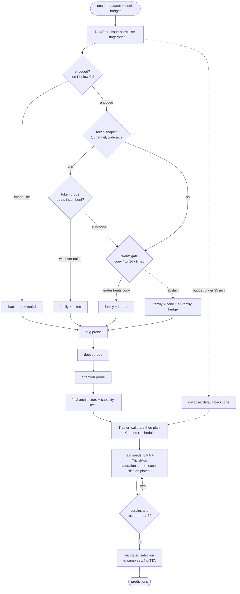

# HerriML — NAS Unseen-Data Challenge 2026

Team **HerriML**'s entry to the [5th NAS Unseen-Data Competition](https://www.nascompetition.com/)
at AutoML 2026. The challenge: design one Neural Architecture Search pipeline that, given a
completely **unseen** image-classification dataset and a fixed time budget, processes the data,
searches an architecture, trains it, and returns predictions — with no per-dataset tuning.

**Authors:** Luis Melzer · Sebastian Seifert · Leander von Gottberg
**Supervisors:** Dr. Marcel Wever · Prof. Marius Lindauer

## Status: complete

The final pipeline is **v13**, shipped as [`submissions/v2/`](submissions/v2). It passed the
Phase-2 grader (ran clean on all three hidden dummy datasets, no errors), so it is our
locked-in Phase-3 entry. In our own finals dress rehearsal at the Phase-3 operating point
(~8 h/dataset) it projected **ahead of the 2025 winning entry on all three finals datasets**.
Full evidence is in the pipeline notes (see *Repository layout* below).

## The pipeline in one picture

Run once per unseen dataset. **Diamonds** are runtime decisions; **dashed** edges are the
abstain-to-default and low-budget-collapse routes. Every gate is a short *real* training plus a
noise estimate — measured, never predicted — and every ensemble choice is a validation comparison.



For the exact stage logic, all constants, and the reasoning behind each decision, read the
**v13 Final Spec** note (path below).

## What ships (the grader contract)

The grader copies four files next to its own `evaluation/main.py` and calls them in sequence:

```
DataProcessor.process()          -> (train_loader, valid_loader, test_loader)
NAS.search()                     -> torch.nn.Module
Trainer.train()                  -> trained model
Trainer.predict(test_loader)     -> list[int]
```

File names and class signatures are fixed. The shipped package is a **flat zip** of five files
(no folder, no `main.py`/`score.py`):

```
submissions/v2/  ->  data_processor.py  nas.py  trainer.py  helpers.py  requirements.txt
```

`requirements.txt` pins only `torch` and `numpy` (everything else is Python stdlib), with loose
ranges and no CUDA-suffixed wheels so it resolves on the grader's driver. A `clock` object is
passed to every stage; the pipeline reads `clock.check()` / `metadata["time_remaining"]` and
adapts — it hard-codes no wall-clock budget. Time / memory / shape failures score −10.

## Quick start (local development)

```bash
# 1. Public datasets (gitignored; override the destination with DATASETS_DIR=...)
./scripts/download_datasets.sh                 # all datasets
./scripts/download_datasets.sh Sudoku          # or filter by name

# 2. Run the local mock grader (mirrors evaluation/main.py + scoring)
pip install -r dev/requirements-dev.txt
python dev/mock_harness.py --submission-dir submissions/v2 --score Sudoku
python dev/mock_harness.py --submission-dir submissions/v2 --time-limit 0.05 GameOfLife   # 3-min collapse test

# 3. Build the submission zip (flat: the 4 files + requirements.txt)
cd submissions/v2 && zip -j ../../nas_submission.zip data_processor.py nas.py trainer.py helpers.py requirements.txt
```

`dev/mock_harness.py` replicates the grader's failure modes (clock exits, test-loader
assertions, blanket-exception → −10), so passing it is our best local signal for Phase 2.

## Repository layout

| Path | What lives here |
|------|-----------------|
| **`submissions/v2/`** | **The shipped submission (v13).** The four contract files + `requirements.txt`. |
| `submissions/v1/` | v12.1 fallback — identical code minus the two v13 changes. |
| `baselines/` | The full research history: every pipeline iteration (`v2` … `v13`) and the reference methods / architecture probes it was measured against. `v13` is the dev source of the shipped code. |
| `dev/` | Local-only tooling: `mock_harness.py` (grader stand-in), run scripts, analysis, dataset generators. |
| `scripts/` | `download_datasets.sh` — pulls the public datasets. |
| `docs/notes/` | The project notebook (Obsidian vault). Start at [`docs/notes/README.md`](docs/notes/README.md); the pipeline story is under `09 - Implementation/.../pipeline/` (see **Pipeline v13 - Final Spec** and **v12.1 - Validation Results**). |
| `docs/proposal/` | The project proposal (LaTeX). |
| `datasets/` | Public datasets. **Gitignored**, symlinked to a local path. |

## Results at a glance

- **Phase-2 grader:** clean pass on all three hidden dummy datasets, no errors, well inside the
  time limit (`dev/logs/phase2/herriml-1.log`).
- **16-dataset tier (2 h):** no regression vs the prior pipeline on matched hardware; the token
  family adds a decisive Cryptic win.
- **Finals dress rehearsal (8 h):** GameOfLife 99.99 · Windspeed 19.30 · **Cryptic 78.24** —
  ahead of the 2025 winner (76.15 on Cryptic) on all three, projecting to 1st on that trio.
- **v13 = v12.1 + two dataset-agnostic changes:** gate tie-break off, and a saturation
  early-stop that recovers a fast-GPU overfitting failure without hurting datasets that want long
  training. Both validated; the shipped code is proven equivalent (static + runtime) to the
  research baseline.

## References

- [Starter kit](https://github.com/Towers-D/NAS-Comp-Starter-Kit) — the grader's `main.py` / `score.py` (not vendored).
- [Public datasets](https://github.com/Towers-D/NAS-Unseen-Datasets) — organisers' dataset descriptions.
- [Competition site](https://www.nascompetition.com/) — official rules and timeline.
