^# v10 - Design + Idea Ledger

> **Status:** 🟢 BUILT (2026-06-11): `baselines/v10/` implements the measure-gate-train pipeline with every Phase-A-validated piece; smoke queued behind A6 on spark. Phase A COMPLETE, verdicts below. v10 is an EXPERIMENT, not the submission. | **Topic:** The consolidated verdict on every idea discussed, the v10 design that ships the survivors, and the v11 shortlist.
> **Related:** [[SOTA Scan - Novel Directions]], [[TCN Backbone Excursion]], [[Key Learnings]], [[Run State + Handoff]], [[Probe-Driven Self-Configuration]]

## Phase A verdicts (COMPLETE 2026-06-11, figures: `images/pipeline/`)

What each test was and what it showed. Analysis: `dev/analyze_phaseA.py`; figures: `phaseA_gate_grid.png` (the 39 live bake-off curves, x-axis = wall-clock minutes since epoch TIME varies 1.5s to 268s across datasets/arms, so epoch counts 1..244 at matched ~6 min are expected) and `phaseA_verdicts.png` (the verdict bars).

| Test | What it was | Verdict |
|---|---|---|
| **A1 backbone gate (live)** | 13 datasets x 3 family arms, ~6 min matched short-train, aug off | **VALIDATED with a structure correction.** Routing totals (final adj of picks): fixed tcn2d +59.2, gate-EVERYWHERE +58.5 (NET NEGATIVE: falls into the Myofibre/GeoClassing early-leader traps), **fingerprint+gate +61.2**, oracle +63.2. The fingerprint SKIP is load-bearing. Both conv stress cases passed (Gutenberg, Sudoku: conv leads early where conv truly wins). Language is the one delicate call (early board says tcn2d, truth tcn1d; cost 0.75, bounded). |
| **A2 steepness gate** | analysis from v9: does depth/width search pay? | **Superseded by the stronger finding:** v9's searched-depth NET HURTS vs fixed D=6 (only Cryptic clearly gained). v10 therefore replaces grow-from-minimum with the default-incumbent rule (D=6 incumbent, candidates {4,8} need significant verified wins). Width search DROPPED entirely (v9's one width-prune, MultNIST W=32, scored below the fixed W=48). |
| **A3 aug pre-filter** | zero-cost proxies (naswot+snip) vs the probe's logged decisions | **REJECTED.** 4/7 agreement on unanimous-probe datasets, flips clear calls (CIFARTile, MultNIST, Gutenberg). The proxy wall again; the two-arm probe stays. |
| **A4 TSE in the depth search** | per-candidate loss logging, TSE vs val ranking, 4 datasets | **REJECTED in-family too.** Spearman 0.4-0.6 but top-1 pick DIFFERS from val's on all 4 datasets (Language negative). Val + verification stays. |
| **A5a stem x dilated** | channel-embed vs conv3 stem on the tcn2d backbone | **SHIPS.** Voxel 80.75 vs 79.66, Chesseract 60.17 vs 58.81: wins both (stronger than on conv). Gate stays in_ch >= 8. |
| **A5b aug x family** | Language, tcn1d arms, aug on vs off | **THE BIG ONE: aug decisions do NOT transfer across families.** ON 89.34 vs the conv-derived probe's OFF 86.61 (+2.7). v10 relocates the aug probe AFTER the backbone choice with family-matched arms. |
| **A6 aug-transfer sweep** (running) | tcn2d aug on/off on the 6 tcn2d-routed aug datasets | results pending; informs how many conv-derived decisions flip under the relocated probe |
| **Block A/B** | ours (BN+ReLU) vs canonical TCN (WN+dropout) vs GELU | **Both challengers REJECTED** by the predeclared bar. Canonical collapses (CIFARTile 44.9 vs 68.3: BatchNorm is load-bearing in 2D). GELU wins only Language (+1.5, parked as an encoded-conditional observation). |
| **v9 free retests** | verification fire-rate, width/depth caps, from logs | **Verification KEEPS ITS JOB:** 13 fires in v9 s42 with real depth-false-strike rescues and a width-mirage rejection. Depth cap D=8 was hit (AddNIST, MultNIST, Sudoku, Voxel). |

## Idea Ledger: what is good, what is rejected, what will not work

### Validated, ship in v10
| Idea | Evidence |
|---|---|
| Dilated TCN-2d backbone, searched depth/width | fixed version +59.2 vs conv +48.2 (seed 42); v9 3-seed sweep running |
| Train-to-budget (no early stop, LR to 0) | 5 wins / 2 ties / 0 regressions; recovered MultNIST on its own |
| Aug-safety probe (two-arm, measured decision) | the durable P1 win (+4.2 on Language); the model for every other probe |
| Macro verification (re-train before trusting) | cured the v6 GameOfLife and Sudoku failures |
| Backbone gate, abstain-to-default | offline: beats fixed default at every budget (+1.0 to +1.7), never below it; the only signal with that property |
| Random arm, budget-gated, kept only if significantly better | Chesseract +0.90 vs conv +0.30, all 3 seeds; loses elsewhere, so the gate is mandatory |
| Fingerprint probe as a WEIRDNESS DETECTOR | see below: cleanly separates the 4 encoded datasets from the 9 image-like ones (gap 0.07 vs 0.38 in corr1) |

### The fingerprint result (2026-06-10, `dev/fingerprint_probe.py`, pure CPU)
The naive hypothesis FAILED: the long-range correlation score does not rank-predict the dilated-vs-conv margin (Spearman ~0.1, partly because saturated datasets compress margins). But the measurement separates data FAMILIES perfectly:
- **corr1 near zero (< 0.1): encoded/symbolic data.** Language (-0.03), Sudoku (-0.05), Chesseract (-0.00), Gutenberg (0.07). Neighboring pixels are independent symbols, the image prior is wrong. These are EXACTLY the four datasets where the default backbone loses or a specialist wins (tcn1d on Language, conv on Sudoku/Gutenberg, random search on Chesseract). Next candidate above the gap: Cryptic at 0.38, a 5x separation.
- **corr1 high (> 0.8): image-like.** Within these, half_dist separates long-range (CIFARTile 8, Myofibre 16, Voxel 8, GeoClassing 24) from local digits (AddNIST 3, MultNIST 3). TCN-2d never loses on this family.
So: not a margin regressor, but a clean, zero-training trigger for the specialist arms (sequence + random) on encoded data. This is the refined Gap-2 claim for the proposal.

### Promising, needs its Phase A test before shipping
| Idea | Test | Criterion |
|---|---|---|
| Steepness gate (skip depth/width search when the landscape is flat) | reuse backbone-gate curves; check it skips exactly where v7-v9 searches returned the default | leave-one-out regret > 0 vs always-search |
| Aug pre-filter (zero-cost shortlist, then the trusted two-arm probe) | compare proxy ranking vs the logged probe decisions, all seeds | agreement on the clear calls, never flips a measured decision |
| TSE + gate inside the depth search (within-family only) | needs per-epoch loss logging in the search, then search-only runs | matches or beats val-acc ranking on known-best depths |
| Frequency (FFT) probe for the dilation schedule | same validation as fingerprint | adds signal beyond corr-decay (else drop: one probe is cleaner) |
| TCN block A/B: canonical + GELU variants (QUEUED behind Phase A, `dev/run_tcnblock_ab.sh`) | three block styles at fixed tcn2d D=6: ours (BN+ReLU), the canonical TCN block (Bai et al. 2018 via the darts `TCNModel`: weight norm + in-block dropout, no BN), and ours with GELU (the modern-activation arm). `PROBE_TCN_BLOCK in {bn, canonical, gelu}`. CIFARTile/Myofibre/Language x 1h, seed 42; all three variants CPU-build-verified | a variant must beat bn by >=0.5 raw pp on >=2 of 3 datasets, else keep ours (it already wins; unnecessary fiddling historically costs more than it pays) |

### Rejected, documented negatives (do not revisit without new evidence)
| Idea | Why it fails |
|---|---|
| TSE for cross-family backbone ranking | biased, not noisy: dilated nets drop loss faster regardless of final quality; degenerates to always-default |
| Learning-curve extrapolation at small budgets | fails on curves with the cosine-LR inflection (-5.9 at 3 min); literature confirms the prior gap |
| Naive bake-off argmax (pick the early leader) | budget-sensitive, swings from -2.3 to +2.2; the gate exists because of this |
| Fingerprint as margin regressor | Spearman ~0.1; refined into the weirdness detector instead |
| Micro op-search (and its fix) | noisy short-train acceptance, the v6 failure; dead micro was protective |
| Rich op vocab inside directed search | v6: -12.1 net, exotic ops win short-train and crater full-train |
| Zero-shot proxies for architecture ranking | degenerate to parameter counting on this suite |
| LSTM ops inside the search | unsearchable under short-train SGD; superseded by tcn1d as a gated arm |

## v10 AS BUILT (`baselines/v10/`, 2026-06-11)

The implementation differs from the draft below where Phase A said so:
- `data_processor.py`: corr1 fingerprint (numpy, seconds) -> `fp_corr1`/`fp_encoded` in metadata; the P1 probe REMOVED from here; train dataset always built on a MUTABLE AugPolicy.
- `nas.py` (fresh file): fingerprint routing (encoded -> 3-arm gate with abstain-to-conv; image-like -> tcn2d, no bake-off); **aug probe relocated here, after the backbone choice, arms of the chosen family** (A5b); default-incumbent depth (D=6 vs {4,8}, significant + verified wins only); NO width search (v9 evidence); random arm encoded-only, budget-gated; decision record `<codename>_decisions.json` per dataset; budget fractions of the clock (gate 18% encoded-only, aug 8%, depth 14%, random 12%) with low-budget collapse (<35 min: no gate/search/random, encoded defaults to conv; <15 min: no aug probe either).
- `trainer.py`: train-to-budget defaults (PATIENCE 999, MAX_EPOCHS 600).
- Smoke: Language (encoded full path), Voxel (image path + embed stem), Sudoku at 0.15h (the collapse path), queued behind A6.

## v10 design: the best-we-can-do pipeline (original draft, kept for context)

Principle (the whole project in one line): measure first, decide only when the evidence beats the noise, otherwise keep the strong default, and spend every saved minute on training.

Per dataset, with a budget ledger and fractions that scale to the real time limit:

```
0. Decision record opened (JSON; every stage appends measurements,
   decision, margin vs noise, time spent, fallback taken)
1. MEASURE  (<1 min, CPU): metadata + corr-decay fingerprint
   -> flags: encoded? long-range? channel count (stem choice)
2. AUG      (~5-8 min): two-arm probe (optionally zero-cost pre-filter)
3. BACKBONE BRANCH (the fingerprint decides if the bake-off runs at all):
   corr1 HIGH (image-like, 9 of 13 public ds) -> SKIP the bake-off
   entirely, backbone := TCN-2d (it never loses on this family), the
   ~15 min go to training. corr1 LOW (encoded) -> run the full gate
   (conv vs tcn1d vs tcn2d short-train); pick the leader only if its
   margin beats the noise, else abstain to the encoded-prior default
   (current best: conv, the most robust arm on the encoded family; Phase A LOO may revise)
4. STEEPNESS GATE (free, reuses gate curves): flat landscape ->
   skip the depth/width search entirely
5. SEARCH   (0-25 min, only if steep): EGNAS depth/width inside the
   winning family + verification (+ TSE gating if Phase A passes).
   v10 change (CORRECTED 2026-06-10 after the full v9 s42 arch map): the
   search INCUMBENT starts at the validated default (D=6 dilated, the +59.2
   config), and any deviation, shallower or deeper, must beat it
   significantly. Rationale: on the ENCODED datasets the search mis-picks
   depth in BOTH directions (Language D=7 -> 85.3 vs fixed D=6 88.2;
   Sudoku D=8 -> 75.8 vs fixed D=6 88.1), while its shallow picks on
   image-like data were harmless or good (GeoClassing D=4 tied the fixed
   D=6; CIFARTile D=5 beat it). So: no depth floor needed (an earlier
   draft said D_MIN=5 based on a misread arch log, the D=4 picks were NOT
   the problem); the default-incumbent rule alone is the fix, and on
   encoded data the macro gate routes away from the dilated family anyway.
6. RANDOM ARM (0-15 min, only if fingerprint says encoded AND budget
   remains): K wide samples, keep only if significantly better
7. TRAIN-TO-BUDGET the winner (cosine to LR 0, EMA, best-checkpoint)
```

Failure containment: every stage has a timeout and a fallback to the previous default; the worst case degrades to plain v9 behavior, never to a crash.

### Pipeline diagram (current-best design, renders in Obsidian)

Reading guide: diamonds are the runtime yes/no gates; every branch states what results from it. Dashed = the abstain/default path (bounded downside by construction). Blue = cheap measurement, yellow = gated probes, red = the one expensive stage. AS BUILT in `baselines/v10/` (2026-06-11): aug probe AFTER the backbone choice with family-matched arms and the asymmetric off-margin rule (A5b + A6); micro = depth only with the D=6 incumbent (width search and TSE dropped per Phase A); low-budget collapse included.

```mermaid
flowchart TD
    classDef measure fill:#e8f3fc,stroke:#1f77b4,color:#000
    classDef gate fill:#fff3cd,stroke:#b8860b,color:#000
    classDef train fill:#fdecea,stroke:#b53030,color:#000
    classDef defpath fill:#f0f0f0,stroke:#888,color:#333,stroke-dasharray: 5 4
    classDef art fill:#f6f0fa,stroke:#7d5ba6,color:#000

    IN["unseen dataset<br/>metadata + clock"]
    FP["1 MEASURE (DataProcessor)<br/>fingerprint: corr1 on raw tensors<br/>CPU, seconds"]:::measure

    subgraph MACRO["2 MACRO: backbone in {conv, tcn1d, tcn2d}"]
        DENC{"encoded data?<br/>corr1 < 0.2"}
        SKIPBO["skip the bake-off<br/>backbone := TCN-2d<br/>(+ channel-embed stem if ch >= 8)<br/>saved time -> training"]:::defpath
        GATE["BACKBONE GATE<br/>short-train {conv, tcn1d, tcn2d}<br/>matched wall-clock"]:::gate
        DLEAD{"leader clearly beats<br/>the conv arm?<br/>(margin > noise)"}
        PICK["backbone := leader"]
        PRIOR["backbone := conv<br/>(encoded default)"]:::defpath
    end

    subgraph AUGB["3 AUG PROBE: family-matched, AFTER the backbone choice"]
        ARMS["two small arms OF THE<br/>CHOSEN family: aug-on vs aug-off"]:::measure
        DAUG{"off wins by a CLEAR margin?<br/>(asymmetric: aug = regularization,<br/>off leads at probe horizons)"}
        AUGOFF["aug := off + mixup"]
        AUGON["aug := on<br/>(metadata default)"]:::defpath
    end

    subgraph MICRO["4 MICRO: depth only, D in {4, 6, 8}"]
        DEPTH["short-train candidates {4, 8}<br/>incumbent = default D=6<br/>(skipped for tcn1d / low budget)"]:::gate
        DCAND{"candidate beats incumbent<br/>> noise AND verified<br/>at a longer horizon?"}
        ADOPT["adopt searched depth"]
        KEEPD["keep default D=6"]:::defpath
    end

    subgraph RANDB["5 RANDOM ARM: arch ~ {11-op vocab} x D in {3..12} x W in {16,24,32,48}"]
        DRAND{"encoded AND<br/>budget remains?"}
        RAND["sample K=6 wide archs,<br/>short-train each"]:::gate
        DRBEST{"clearly > incumbent?<br/>(margin > 2x noise)"}
        RADOPT["adopt random arch"]
        RDISC["discard,<br/>keep incumbent"]:::defpath
    end

    TRAIN["6 TRAIN-TO-BUDGET<br/>cosine to LR=0, EMA, best checkpoint"]:::train
    OUT["predictions"]
    COLL["low-budget collapse:<br/>< 35 min: no gate / depth / random,<br/>encoded -> conv default;<br/>< 15 min: no aug probe either"]:::defpath

    IN --> FP --> DENC
    DENC -.->|"no: image-like (9/13)"| SKIPBO -.-> ARMS
    DENC -->|"yes: encoded (4/13)"| GATE --> DLEAD
    DLEAD -->|yes| PICK --> ARMS
    DLEAD -.->|no| PRIOR -.-> ARMS
    ARMS --> DAUG
    DAUG -->|yes| AUGOFF --> DEPTH
    DAUG -.->|no| AUGON -.-> DEPTH
    DEPTH --> DCAND
    DCAND -->|yes| ADOPT --> DRAND
    DCAND -.->|no| KEEPD -.-> DRAND
    DRAND -->|yes| RAND --> DRBEST
    DRAND -.->|no| TRAIN
    DRBEST -->|yes| RADOPT --> TRAIN
    DRBEST -.->|no| RDISC -.-> TRAIN
    TRAIN --> OUT
```



Standalone image version (same structure, for embedding and the proposal): `![[v10_pipeline.png]]`, generated by `dev/plot_v10_pipeline.py`.

Committed-but-pending choices drawn above (flagged so we remember what needs confirming): the encoded abstain-default = conv (most robust across the encoded family so far; Phase A LOO may revise), the steepness gate itself (A2), and the exact noise thresholds (derived, not tuned). Open for the polished matplotlib/Excalidraw version: a budget bar under the flow with the 2h and 1h allocations.

Budget sketch at 2h: 1 + 8 + 15 + (0-25) + (0-15) + 60-90 train. At the real Phase-2 1h, fractions halve and the steepness gate earns its keep (most datasets skip straight to training).

### Runtime intel from the 2026 starter kit (2026-06-10, changes the test plan)
Confirmed from the starter-kit README + `evaluation/main.py` (see [[Phases and Timeline]] for the full rules): Phase 2's 1 hour is explicitly "just testing the code works"; the SCORED Phase-3 run gets "an unknown amount of runtime"; the per-dataset budget arrives via the metadata `time_limit` key (code default 30 MINUTES); a hard termination watchdog (new in 2026) kills overruns; clock manipulation = disqualification. Implications for v10:
1. **Fractions, never minutes.** Every stage budget (probes, gate, search, random arm) must be a fraction of the clock. The pipeline must produce a sane submission at 30 min AND scale gracefully to 12h. At very small budgets the gates should collapse to: fingerprint (seconds) + default backbone + train-to-budget.
2. **The test order (user decision 2026-06-10): comparability first, budget study second.**
   - FIRST the standard v10 sweep at 2h (3 seeds x 13 datasets): directly comparable to every number in the project (v7 +41.94, v8 +48.2, v9 +52.4, fixed tcn2d +59.2) and to the literature comparisons.
   - THEN the budget ladder study: run v10 on 3-4 representative datasets (one image-easy, one long-range, one encoded, one big) at time_limit in {0.5h, 1h, 2h, 4h, 8h}. The decision records show, per budget, which stages fired and what they bought. Deliverable: an evidence-based stage-activation ladder ("below X minutes skip the gate, below Y skip the search, above Z enable the random arm / wider widths"), replacing guessed fractions with measured thresholds. Plus the 1h full-suite crash-safety pass (the literal Phase-2 condition) and one artificially tight hard-kill test.
3. **Hard-kill robustness:** keep the safety margin generous; predictions must be written before the watchdog fires. Test once with an artificially tight kill.
4. **Packaging checklist:** `EXTEND_CLOCK_FOR_NAS` and any clock-touching exploration flag must be stripped or default-off in the shipped submission (disqualification risk).

### Isabella search verdict (2026-06-10)
Searched everywhere: the organisers' `NAS-Unseen-Datasets` repo (README updated 2026-05-31, still "Code Coming Soon"), both organisers' `cvpr-nas-datasets` repos (generators exist for CIFARTile, Gutenberg, Language, MultNIST only, plus `data_packager.py`), the starter kit, GitHub code search. **The Isabella generator is not published anywhere.** Two consequences:
- **DIY path if we want the analog:** the museum audio is public (`gardnermuseum.org/experience/music`) and the recipe is published (5 s clips, 64-band spectrograms, 1x64x128, 4 era labels, Geada section 4.6). Half a day of work, only worth it if the transfer suite's spectrogram stand-in (AudioMNIST/SpeechCommands) shows something interesting.
- **Useful find for the transfer suite:** `cvpr-nas-datasets/data_packager.py` is the organisers' own script for packaging datasets into the competition format. Use it (or mirror it) for CIFAR/EMNIST/MedMNIST packaging instead of writing our own from scratch.

### Overfitting guards (we tune on 13 datasets, the hidden ones are the exam)
- No hand-tuned constants: thresholds derive from measured noise.
- Leave-one-out for every design choice; judged by regret, not 13/13 correctness.
- Bounded downside by construction: wrong decisions fall back to the default.
- Predeclared variants per component, run once, pick by LOO. No re-tuning loops.

### The sweep
v10 x 3 seeds x 13 datasets x 2h, decision records on. Deliverables: total vs v9 and vs fixed tcn2d, plus an auto-generated attribution table (which decision fired where, what it cost, what it gained). One extra 1h-budget pass on the final config before Phase 2 packaging.

### The transfer suite (after the v10 sweep): run v10 on datasets we never designed on
The strongest possible generalization test for an Unseen Data Challenge entry: every design decision so far was validated on the same 13 public datasets, so run the finished v10 on EXTERNAL datasets that played no role in any choice. Two tiers, chosen so BOTH pipeline branches get exercised:

**Tier 1, ordinary images (should take the skip-bake-off path):** CIFAR-10, CIFAR-100, FashionMNIST, SVHN, and especially EMNIST + KMNIST (the datasets the EGNAS paper claims SOTA on, a direct comparison against the 2025 winner's own benchmarks).

**Tier 2, competition-style analogs (should exercise the encoded/specialist branches):**
- MedMNIST family (PathMNIST etc.): medical microscopy, the Myofibre analog, npy-friendly out of the box
- EuroSAT: satellite patches, the GeoClassing analog
- AudioMNIST or SpeechCommands as spectrogram tensors: a modality none of the 13 covers, fingerprint behavior unknown (the interesting case)
- A synthesized cellular automaton with a DIFFERENT rule than GameOfLife (Day and Night, Seeds): trivially generatable, tests whether the GameOfLife win was rule-specific
- Isabella: NOT downloadable (checked 2026-06-10: license issues, the organisers' repo promises "Isabella-like dataset generation code coming soon", worth re-checking before July). Isabella is the audio-spectrogram member of the family, so the AudioMNIST/SpeechCommands spectrogram analog above is its stand-in

What we check, in order of importance:
1. The decision record: does the fingerprint call them image-like, does the gate route to TCN-2d, do the searched depths land sensibly. A wrong family call on ordinary image data is exactly the failure we want to catch before July.
2. Raw accuracy vs literature reference bands (no official benchmark exists for adj scoring, so raw + sanity bands is the deliverable).
3. No crashes/timeouts on data the harness has never seen (Phase-2 dress rehearsal).
Prep: a small packaging script per dataset (train/valid/test npy in CxHxW + metadata file). Cost: ~1-2h per dataset on spark, so a 4-6 dataset suite is half a day to a day. This is also clean poster material: "the pipeline generalizes to datasets never seen during design".

### Iteration trick (decision-phase-only loop)
The probes and gates produce decisions in minutes; the known-best decision per dataset comes from the completed experiments. So the decision machinery iterates WITHOUT training final models: run stages 1-6 only, compare the decision record against best-known, fix, repeat. Full sweeps are reserved for the assembled config.

## Phase A as queued (2026-06-10, runs unattended)

Chain on spark: v9 s42 finishes → `v9_s42_only` watcher kills seeds 1337/2024 → `phaseA_queue` starts `dev/run_phaseA.sh` (~10h GPU):
- **A1 backbone-gate arms:** conv (EGNAS_OFF default) / tcn1d / tcn2d, 13 datasets x 0.12h each, aug off, matched budget → curves for the live gate analysis (thresholds from noise, LOO, regret).
- **A3 aug pre-filter:** `dev/test_aug_prefilter.py`, naswot+snip on aug-vs-clean minibatches through 5 tiny nets, compared against the probe's logged decisions (pass = agreement on unanimous-probe datasets).
- **A4 TSE-in-search:** per-candidate epoch losses now logged (`TSE_LOG` lines, `_short_train` patch); 4 depth-sensitive datasets (GameOfLife, Sudoku, AddNIST, Language) x 0.5h conv depth search → offline TSE-vs-valacc ranking comparison, within-family only.
- **A5 regime retests (Learning 14):** old verdicts re-checked on the new backbone: stem x dilated (Voxel, Chesseract; `PROBE_TCN_STEM=channel_embed`) and aug on/off x tcn1d on Language. Plus two FREE retests from v9 s42 logs: does macro-verification ever fire usefully for the dilated family, and does width-prune / the D=8 cap bind anywhere.
- **A2 steepness gate:** analysis-only, derived from A1's curves + the v7/v8/v9 pools once data lands.

All A5-style retests are seed-42 half-budget direction checks, not precision measurements; anything that flips gets the full treatment.

## Budget-scaled extensions (team decision 2026-06-12)

The budget-ladder idea extended from "stage budgets scale with the clock" to "the pipeline's AMBITION scales with the clock". Three pieces, with the lessons from the rich-vocab failures baked in (the v6-era verdict, precisely stated: per-layer op mixing selected by short-train ranking fails, twice proven; whole fixed architectures evaluated properly succeed: the dilated conv sat unused in the failed vocabulary and was later worth +11 as a fixed backbone).

### 1. Tiered architecture roster + the FAMILY ADMISSION PROTOCOL
New architectures enter ONLY as fixed family arms in the gate (never as vocab ops, never as new search dimensions). The fixed core {conv, tcn1d, tcn2d} is untouchable; arms are additive and reversible. Roster tiers: base arms always; at >=4h budgets add admitted tier-2 families (candidates: row-GRU, MLP-Mixer); at >=8h tier-3 (state-space). A candidate family must pass the gauntlet (~1.5-2 GPU days each) before going live:
1. Full-budget fixed-arch sweep across all 13 (the TCN-excursion recipe). Beats existing arms nowhere -> not admitted (every arm costs gate budget).
2. Rankability check: does the family show its strength within a gate-arm horizon? Determines the budget TIER at which the arm is admissible (recurrent nets thrash in short arms: the BiLSTM evidence; a GRU may only be rankable at 15+ minute arms).
3. Family-matched aug probe (the aug-transfer lesson).
4. Gate replay on recorded curves: confirm routing quality does not degrade (no new Myofibre-style traps).

### 2. Heterogeneous ensemble at long budgets
At >=4h, if >=2 gate arms land within the noise margin, train the top two fully and logit-average; KEEP the ensemble only if it beats the best single on validation (abstain-to-default discipline). Motivation: train-to-budget saturates past ~2h on most datasets; surplus hours convert to accuracy only through diversity. Honest history: same-architecture ensembling was tested before and was MIXED; the new element is cross-family diversity, exactly what that experiment lacked. Validation: an ensemble rung in the budget-ladder study (4h/8h, 3-4 datasets, single-best vs top-2 ensemble).

### 3. Self-generated competition-style datasets (teammates' track)
Candidates: QR codes with ~10% corruption (occlusions / inserted mistakes; the corruption rate is the difficulty dial, and QR is a fingerprint edge case: error correction spreads information, locality means little), tic-tac-toe encoded, minesweeper, time-series-as-image, dominos-with-mistakes. Strongest possible RQ2 test: family expectations are known in advance and the datasets are built blind to the pipeline. Tooling: the organisers' `Towers-D/cvpr-nas-datasets` (`gen_*.py` templates + `data_packager.py` for the exact format); each dataset needs a ResNet-18 benchmark run; SPECS MUST BE FIXED before observing pipeline behavior on them (no design leakage).

**QR is BUILT (2026-06-12): codename Quincy.** Generator `dev/make_qr_dataset.py` (seeded, regenerable; raw arrays gitignored, copy on spark at `~/local/nas-comp-datasets/Quincy`). Spec, fixed before any pipeline run: 20-way classification of version-1 QR codes (1x21x21 binary), payload "C<class>-<8 random alnum>" at ECC level Q, random mask pattern per sample; 10% of samples corrupted (module flips p=0.06 or a 5x5 occlusion), within ECC-Q recoverability so labels stay decodable in principle. 50k/10k/10k splits. Measured properties: corr1 = 0.054 (will route ENCODED, as predicted for QR), same-class pairs differ in ~114/441 modules (no template shortcut), logistic regression 24.9% vs 5% chance (learnable, far from solved). Benchmark placeholder 0.0; ResNet-18 benchmark run still owed. First pipeline run: queue v10 on Quincy after the 3-seed sweep finishes.

### Proposal candidates (drafted, pending user decision)
One budget-scaling sentence in Approach/Required Steps (roster + ensemble) and the self-generated datasets in Evaluation Strategy.

## v11 shortlist (parked until v10 lands)

The TCN excursion's meta-lesson: one different architecture family was worth +11, so screening more families is high-prior. The fingerprint tells us where to aim: the encoded datasets (Language, Sudoku, Chesseract, Gutenberg) are where the image prior fails and our wins are thinnest. Candidates, all SGD-trainable and budget-friendly, screenable in half a day each with the existing PROBE_ARCH harness:
1. **State-space models (S4/Mamba-style 1-D blocks):** the modern sequence family beyond TCN; aimed at Language/Cryptic, possibly stronger than tcn1d.
2. **MLP-Mixer-style nets:** no spatial prior at all; plausible exactly on encoded data where locality is meaningless (corr1 ≈ 0).
3. **ConvNeXt-style modernized conv block:** a stronger image default; tests whether our plain conv arm undersells the conv family.
4. **Wide random-graph nets (RandWire-flavored):** ties into the random arm; for the Chesseract-type inputs where wide random sampling already wins.
5. **SpatialSelfAttn2D as a gated candidate on board-like encoded data (added 2026-06-12):** attention-after-stem keeps winning on Chesseract. The s1337 Chesseract adoption (64.8 val, +6.1 over s42, above the all-time competition best 63.0) is the only sampled arch with self-attention directly after the stem (Identity, SpatialSelfAttn2D, MaxPool, MaxPool, Conv3, Conv5, W=16); piece interactions on a board are non-local, which is exactly what attention buys over convs on an 8x8 grid. Promotion path: run the family admission gauntlet on a small attn-after-stem template (encoded route only, corr1 < 0.2 with small spatial dims), so the win stops depending on the random arm sampling it by luck. NOTE: do not over-read "board games love attention" -- see item 6, the same random arm REGRESSED Sudoku on s1337.
Protocol: fixed-arch probe x 13 datasets x seed 42 (the TCN excursion recipe), then the gate decides deployment. ViT-style attention stays deprioritized: data-hungry at our scale and attention already failed on Language (84.8). Note the distinction with shortlist item 5: a single lightweight attention layer inside a tiny W=16 net on an 8x8 board is a different regime from a full attention backbone on sequence data.

6. **HIGH PRIORITY -- give the random arm re-train verification (found in the s1337 sweep, 2026-06-12).** Confirmed regression: on Sudoku s1337 the random arm adopted a 12-op W=32 net whose short probe scored 0.95, but at full train-to-budget it realised only 86.2 best-val, BELOW the conv-6 incumbent (probe 0.871, and s42's conv-8 realised ~98). Net cost roughly -12 points on that dataset versus simply keeping the incumbent. Root cause confirmed in `baselines/v10/nas.py:357`: the random arm adopts on a single short-probe score (`v > best_r + 2*noise`) with NO re-train verification, whereas the depth search (`nas.py:319-328`) re-trains the challenger fresh at a longer horizon before trusting it (that guard fires 13 times in v9 s42 and was added precisely to cure this failure mode). The random arm is the last unverified adoption in the pipeline. Fix: re-train the single best random sample fresh, longer horizon, and adopt only if it still beats the incumbent by > noise -- the exact pattern depth search already uses. Caution on tuning: the verification slice has to come out of RAND_FRAC so the final train-to-budget is not shortened. This is the difference between the random arm being a pure upside option (Chesseract +6) and a coin-flip (Sudoku -12); with verification it should keep the wins and drop the losses. Validate by replaying Sudoku/Chesseract s1337 with the verified arm before the next full sweep.
   **DONE 2026-06-15:** implemented in `baselines/v10/nas.py` (re-train best random arch at `cand_s*2`, adopt only if `verified > incumbent + noise`; `cand_s = slice_s/(RAND_K+2)` reserves the verify budget). Validating on Sudoku+Chesseract s1337.

## v11 build queue + directions (updated 2026-06-15)

Decided order: random-arm verify (done) -> additional architectures + ensemble + verified width-search -> THEN the budget ladder (so the long rungs exercise the new capabilities, otherwise 8h is wasted). All running/queued via `dev/run_extensions_sweep.sh` after the random-arm validation.

7. **Architecture-family gauntlet (queued 2026-06-15).** `baselines/arch_probe/` runs a FIXED arch per family (PROBE_ARCH env) on {Chesseract, Sudoku, Language, CIFARTile}: **attn** (SpatialSelfAttn2D, the board lead), **recur** (RowBiLSTM, the v7 Language cracker), **modern** (Conv7+SEConv3+ResNeXt, ConvNeXt-ish). All from existing vocab ops (no new blocks). Where a family beats tcn2d/conv it becomes a gated candidate admitted at >=4h. Mamba / MLP-Mixer need new block code -> later.
8. **Long-budget ensemble (queued 2026-06-15).** `baselines/ensemble_probe/` = conv+tcn2d+tcn1d logit-average, on {Chesseract, Sudoku}. Tests whether a cross-family ensemble beats the single best at the same budget (E1: ensembles are conditionally, not universally, useful). The "what to do with surplus time at 8h" answer.
9. **Verified width-search (DONE + queued 2026-06-15).** `WIDTH_SEARCH=1` env-gated stage in v10 (default off): default-incumbent W=48 vs {32,64}, short-train + re-train verify before adopt -- the SYSTEMATIC version of "search width again", not random sampling. Width-prune cratered in v9 only because it had no verification; the verify machinery (now proven on depth/random/width) makes it safe to revisit. Run on 4 encoded datasets.
10. **Real macro (heterogeneous-block) search -- from [[2022 - BLOX Macro NAS Benchmark]] (2026-06-15).** v10 builds UNIFORM stacks (every block the same; depth/width only tune the skeleton). BLOX shows heterogeneous-block nets Pareto-DOMINATE uniform ones (headroom), but also that proxy/signature block-quality scores are unreliable (independent confirmation of our wall). So a real macro search must be VERIFY-heavy. The random arm is already a crude verified macro sampler (random per-layer ops); the principled v11 version is a systematic, verified heterogeneous-block search. Caution: BLOX's own result says the naive proxy route fails -- exactly what killed our micro.
