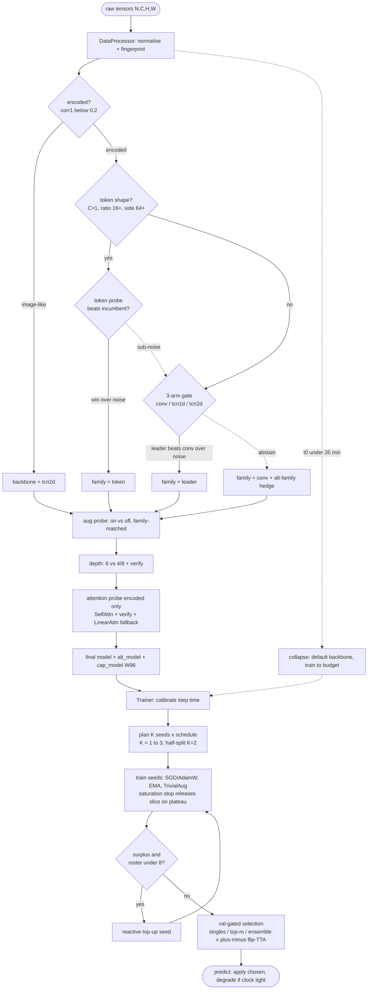

# Pipeline v13 - Final Spec (the shipped submission, exact detail)

> **Status:** FINAL, shipped 2026-07-16 as `submissions/v2` (v13); `submissions/v1` =
> v12.1 fallback. | **Results:** [[v12.1 - Validation Results]] section "v13". |
> **Contract:** [[Submission Contract]]. | **Lineage:** v10 -> v11.1 -> v12 -> v12.1 ->
> **v13**. v13 = v12.1 + tie-break-OFF + saturation-stop, nothing else.

This note describes exactly what the four shipped files do, stage by stage, with the
concrete constants. Everything is **measured, never predicted** (the proxy-wall lesson):
every gate is a short real training + a noise estimate, every selection is a val
comparison. The whole pipeline reads `clock.check()` / `metadata["time_remaining"]` and
adapts; it hard-codes no wall-clock budget.

## Pipeline at a glance

Run once per unseen dataset. Diamonds are runtime decisions; dashed paths are the
abstain-to-default and low-budget-collapse routes.



---

## 0. The four files (grader contract)

```
data_processor.py   class DataProcessor(train_x,train_y,valid_x,valid_y,test_x,metadata,clock)
                                        .process() -> (train_loader, valid_loader, test_loader)
nas.py              class NAS(train_loader, valid_loader, metadata, clock).search() -> nn.Module
trainer.py          class Trainer(model, device, train_loader, valid_loader, metadata, clock)
                                        .train() -> nn.Module ; .predict(test_loader) -> list[int]
helpers.py          shared model builders + ops + EMA + LR schedule + augmentation
```
Only `torch` + `numpy` are imported (everything else is stdlib). The grader saves
predictions itself (`np.save`); our code writes nothing to disk.

Flow: raw arrays -> **DataProcessor** -> 3 loaders -> **NAS** -> model -> **Trainer.train**
-> trained model -> **Trainer.predict** -> label list.

---

## 1. DataProcessor -- normalise + fingerprint

1. **Per-channel normalisation** from the train split (`per_channel_stats`).
2. **Fingerprint** (seconds of CPU on raw tensors), written into `metadata` for the NAS:
   - `fp_corr1` = mean local pixel correlation (adjacent-cell agreement).
   - `fp_encoded` = `fp_corr1 < ENCODED_CORR1 (0.2)`. Below the threshold the data is
     symbolic/encoded and the image prior (local smoothness) is wrong. Empirically splits
     the encoded public sets from the image-like ones with a ~5x gap (~0.07 vs ~0.38).
3. **Loaders**: train uses a MUTABLE `AugPolicy` derived from metadata (the NAS toggles it
   in place after it picks a backbone); valid + test are un-shuffled. Test loader uses an
   explicit `SequentialSampler` (the grader asserts no `RandomSampler`).

The aug-*safety* decision is NOT made here -- it moved into the NAS (it must run after the
backbone choice, with arms of the chosen family, because the decision does not transfer
across families).

---

## 2. NAS -- measure-gate-train (`search()`)

Budget-fraction constants are of the clock remaining at search start (`t0`). Each probe
"leg" is sized by `_slice(t0, frac, parts)` = `t0*frac/parts`, floored to `PROBE_LO_S`
(120s, only when `t0 > PROBE_FLOOR_BUDGET_S` = 4h) and capped at `PROBE_HI_S` (420s).

**Low-budget collapse** (guards the whole search):
- `t0 < COLLAPSE_FULL_S` (35 min): skip gate/depth/attention -> informed default backbone.
- `t0 < COLLAPSE_AUG_S` (15 min): skip even the aug probe.
- At the ~30-min Phase-2 budget the pipeline collapses to fingerprint + default backbone +
  train-to-budget -- it runs and predicts, it just does not search.

**Stage 1 -- fingerprint** (read from metadata): `corr1 < 0.2 -> encoded`.

**Stage 2 -- backbone**:
- *image-like* (`not encoded`): pick `tcn2d`, no bake-off (`backbone_skip`).
- *encoded*: 3-arm **gate** (`GATE_FRAC 0.18`): short-train `conv`, `tcn1d`, `tcn2d` at a
  matched slice, take the leader ONLY if it beats the `conv` arm by more than the measured
  noise, else **abstain to conv**. When the margin is within noise, record the runner-up as
  `alt_family` (a sub-noise coin flip). `GATE_TIEBREAK` is **False** in v13 (re-measuring
  the top-2 was a val->test mismatch; the abstain + alt-hedge is cheaper and better).
- **Token gate** (`TOKEN_ARM`, shape-based not fingerprint-based): fires only when
  `in_ch == 1 and max(H,W) >= TOKEN_RATIO_MIN(16) * min(H,W) and max(H,W) >= 64`. Among all
  known datasets only Cryptic (1x6x768) matches. Short-trains a `TokenSeqNet` (rows =
  tokens, wide axis = embedding, Transformer encoder, AdamW recipe) vs the incumbent; adopts
  token only when it wins beyond noise, else keeps the incumbent and (optionally) spends the
  alt-family hedge seed on token downstream.

**Stage 3 -- aug probe** (`AUG_FRAC 0.08`, skipped for token / low budget): short-train
aug-ON vs aug-OFF with arms of the CHOSEN family; keep the metadata aug policy only if it
does not hurt beyond noise.

**Stage 4 -- depth** (`DEPTH_FRAC 0.14`): incumbent `DEFAULT_DEPTH 6` vs `DEPTH_CANDS (4,8)`;
a candidate must beat the incumbent beyond noise at short-train AND survive a longer-horizon
verification before adoption. `DEFAULT_WIDTH` stays 48 (the width/macro searches were
validated no-ops and are not in the shipped pipeline).

**Stage 5 -- attention probe** (encoded/board data only, budget permitting): replace the
first `ATTN_STAGES (2)` blocks with `SpatialSelfAttn2D`; short-train vs the family default,
then VERIFY the challenger at 1.5x horizon, adopt only if it beats the default beyond noise.
Hardened: one retry, then fall back to the shape-robust `LinearAttn2D` (cannot crash on odd
grids); every failure is logged, never a silent reject.

**Final build + side-channels** attached to the returned model as `_v12_meta`:
- `alt_model`: a built runner-up-FAMILY model (when the gate was a sub-noise coin flip) for
  one val-gated ensemble seed.
- `cap_model`: a `CAP_ARM_WIDTH (96)` wider twin of the FINAL architecture, one val-gated
  seed at large budgets (`CAP_ARM` on). Helps scaler data only; val decides.

---

## 3. Trainer -- budget-adaptive controller (`train()` / `predict()`)

### 3a. Calibrate
Run a handful of real steps on the actual model/data (~4 steps), measure step time, restore
the init state. -> projected seconds per epoch on THIS hardware. Re-projected between seeds
so a slow seed shrinks or drops the ones after it.

### 3b. Plan (`_plan`)
`proj = usable_clock / epoch_time`. Then:
```
k = 1
if proj >= SPLIT_FACTOR(1.5) * FULL_EPOCHS(600):   k = min(MAX_SEEDS(3), proj // FULL_EPOCHS)
if k <= 1 and proj >= 2 * MIN_SEED_EPOCHS(300):     k = 2      # half-split band
schedule = min(CAP_EPOCHS(2400), proj / k)
```
So K in {1,2,3} planned; the half-split takes K=2 as soon as each seed still gets >=300
epochs (the v12.2/v12.3d verdict, already the default). Surplus beyond MAX_SEEDS full
trainings goes into LONGER schedules up to the cap -- the "uncapped-training" lesson.

### 3c. Seed roster
`roster = [primary]*k`; alt-family model at slot `k-1` (K>=2); capacity twin at slot `k-2`
(K>=3). Heterogeneous seeds carry their own module (parallel `seed_models`).

### 3d. Train one seed
- Optimiser: token/`_v12_recipe=="adamw"` -> AdamW(3e-4, wd 0.05); else SGD(0.025, mom 0.9,
  wd 3e-4, nesterov). LR = warmup(`LR_WARMUP_EPOCHS 5`) then cosine to 0 over the schedule.
- `EMA` (decay 0.999), `LABEL_SMOOTHING 0.1`, **TrivialAugment** (`USE_TRIVIAL_AUG`, one
  random op at random magnitude per batch, keeps `flip_h`), NaN recovery (restore best,
  lr/5, restart; 3 strikes out), channels_last.
- Schedule re-anchored at epoch 0 to what the seed's slice actually affords (never above the
  plan, so the anneal completes).
- **Saturation early-stop (v13)**: a separate patience anchor advances only when val clears
  the run's OWN measured noise (std of the last `SATURATE_WINDOW 15` vals). When val
  plateaus (wobbles within noise) the anchor freezes; if no noise-clearing gain for a
  schedule-relative window (`SATURATE_FRAC 0.25` of the seed's schedule, floor `2*WARMUP`)
  the seed STOPS and releases its slice. `best_val`/checkpoint is tracked independently, so
  the true-best weights are always kept. Datasets that keep improving clear their own noise
  and train on; saturated ones release compute into more seeds (ensemble diversity).
- **Perfect-stop**: val >= `PERFECT_ACC 0.9995` on two consecutive epochs -> release slice.

### 3e. Reactive top-ups
After the planned K seeds, if measured surplus remains (released by perfect-stop / saturation
/ finishing under budget) and `roster < HARD_CAP_SEEDS(8)`, append another seed (the unused
capacity twin first, else a primary replica). Reactive off MEASURED releases only -- never
predicted saturation.

### 3f. Val-gated selection (`_select`)
Compute val for every config: each single seed, top-m ensembles (m=2..K over val-ranked
seeds), the full ensemble -- each x {no-TTA, flip-TTA}. Pick the argmax, but prefer an
ensemble config when its val is within `SEL_BAND (0.25 pp)` of the argmax single (ensembles
generalise better than they val). Everything measured on val; extra passes are clock-guarded.

### 3g. predict()
Apply the chosen config to the test loader; degrade to single-best if the clock would not fit
the ensemble / TTA passes. Returns a label list; the grader saves it.

---

## 4. Constant reference (shipped v13 defaults)

| where | constant | value | role |
|---|---|---|---|
| nas | GATE/AUG/DEPTH/RAND_FRAC | 0.18/0.08/0.14/0.12 | probe budget fractions of t0 |
| nas | PROBE_LO_S / HI_S / FLOOR_BUDGET_S | 120 / 420 / 14400 | probe leg floor/cap; floor only above 4h |
| nas | GATE_TIEBREAK | **False** | (v12.1: True) sub-noise re-measure OFF |
| nas | TOKEN_ARM / TOKEN_RATIO_MIN | True / 16 | shape-gated token family |
| nas | CAP_ARM / CAP_ARM_WIDTH | True / 96 | val-gated wide twin |
| nas | COLLAPSE_FULL_S / AUG_S | 2100 / 900 | low-budget skip thresholds |
| nas | DEFAULT_DEPTH / DEPTH_CANDS / DEFAULT_WIDTH | 6 / (4,8) / 48 | arch incumbents |
| nas | STEM_EMBED_MIN_CH / ENCODED_CORR1 | 8 / 0.2 | channel-embed stem / encoded flag |
| trainer | FULL_EPOCHS / CAP_EPOCHS | 600 / 2400 | reference / max schedule |
| trainer | MAX_SEEDS / HARD_CAP_SEEDS | 3 / 8 | planned / after top-ups |
| trainer | SPLIT_FACTOR / MIN_SEED_EPOCHS | 1.5 / 300 | multi-full / half-split thresholds |
| trainer | SEL_BAND | 0.25 | ensemble-preference band (pp) |
| trainer | SATURATE / _FRAC / _WINDOW | True / 0.25 / 15 | **v13** saturation stop |
| trainer | WARMUP_EPOCHS / PATIENCE / PERFECT_ACC | 20 / 999 / 0.9995 | early stops |
| trainer | LR_SCALE / LR_WARMUP / LABEL_SMOOTHING / EMA_DECAY / SEED | 1.0 / 5 / 0.1 / 0.999 / 42 | recipe |

Only difference between shipped v1 (v12.1) and v2 (v13): `GATE_TIEBREAK` default, and v13's
three `SATURATE*` constants + their ~30 lines of code. Verified `submissions/v1` vs `v2`
byte-identical except those.

---

## 5. Design principles (why it is shaped this way)

1. **Measured, not predicted.** The v6 proxy-wall killed all cheap difficulty prediction.
   Every gate is a short real training + a noise floor; every selection is a val comparison.
2. **Abstain on ambiguity.** Sub-noise gate margins are coin flips -> abstain to the safe
   incumbent (conv) and hedge with a runner-up-family ensemble seed, rather than commit.
3. **Val-gated surplus.** Extra compute buys more seeds / ensembles / longer schedules, each
   accepted only if val says so. Never a predicted improvement.
4. **Dataset-agnostic self-signals.** The saturation stop and the token gate use only the
   run's own trajectory / the input shape -- nothing tuned to the 16 public datasets, so
   they generalise to the hidden Phase-3 sets.
5. **Reliability first.** Hardened probes (retry + fallback, never silent), NaN recovery,
   clock-guarded everything, safety margin so predictions are written before the watchdog.

---

## 6. Further work (post-submission; see recommendation in the session)

Validated and DONE: token family, tie-break-off, saturation stop, half-split, W96 capacity,
probe floors/caps. CLOSED negative: BDH (flat across 15x params), indep-init, W128, weight
soups, SAM/self-distill/AdamW-as-default, difficulty routing.

Open levers, in decreasing value / increasing effort:
- **Cryptic-class architecture** -- the only remaining route to the 2025-winner gap on that
  family; the token head already jumped it to 78.6. A research item (transformer variants,
  feature-space input), not a knob.
- **CIFARTile capacity at 8h** (W128) -- compute/hardware-bound; cannot control grader HW.
- **Probe-floor-below-4h** -- a one-constant candidate for the residual Chesseract 2h gate
  variance; marginal.
- **L40S/Ada-proxy run** -- eval-hardware fidelity; A100/H100 already bracket it.

**Recommendation: v13 is the submission.** With Phase 2 being pass/fail infra validation on
dummy data (no scored feedback), and "last successful advances", the priority is confirming
v13 runs on the grader's box, not chasing marginal unvalidated changes -- a late regression
is the dominant risk. Re-running the finals dress rehearsal (GameOfLife/Windspeed/Cryptic
@8h) under v13 would update the Phase-3 projection (Cryptic now 78.6 vs the old 72.8) but
does not change the submission.
