^# v10 - Design + Idea Ledger

> **Status:** 🟡 design phase (2026-06-10). v9 reduced to seed 42 only (watcher auto-cancels seeds 1337/2024); Phase A fully scripted and AUTO-QUEUED behind it. v10 is an EXPERIMENT, not the submission. | **Topic:** The consolidated verdict on every idea discussed, the v10 design that ships the survivors, and the v11 shortlist.
> **Related:** [[SOTA Scan - Novel Directions]], [[Tier 2a - TCN Excursion]], [[Key Learnings]], [[Run State + Handoff]], [[Probe-Driven Self-Configuration]]

## Idea Ledger: what is good, what is rejected, what will not work

### Validated, ship in v10
| Idea | Evidence |
|---|---|
| Dilated TCN-2d backbone, searched depth/width | fixed version +59.2 vs conv +48.2 (seed 42); v9 3-seed sweep running |
| Train-to-budget (no early stop, LR to 0) | 5 wins / 2 ties / 0 regressions; recovered MultNIST on its own |
| Aug-safety probe (two-arm, measured decision) | the durable P1 win (+4.2 on Language); the model for every other probe |
| Macro verification (re-train before trusting) | cured the v6 GameOfLife and Sudoku failures |
| Backbone gate, abstain-to-default | offline: beats fixed default at every budget (+1.0 to +1.7), never below it; the only signal with that property |
| Random arm, budget-gated, kept only if significantly better | Chesseract +0.90 vs conv +0.30, all 3 seeds; loses elsewhere, so the gate is mandatory |
| Fingerprint probe as a WEIRDNESS DETECTOR | see below: cleanly separates the 4 encoded datasets from the 9 image-like ones (gap 0.07 vs 0.38 in corr1) |

### The fingerprint result (2026-06-10, `dev/fingerprint_probe.py`, pure CPU)
The naive hypothesis FAILED: the long-range correlation score does not rank-predict the dilated-vs-conv margin (Spearman ~0.1, partly because saturated datasets compress margins). But the measurement separates data FAMILIES perfectly:
- **corr1 near zero (< 0.1): encoded/symbolic data.** Language (-0.03), Sudoku (-0.05), Chesseract (-0.00), Gutenberg (0.07). Neighboring pixels are independent symbols, the image prior is wrong. These are EXACTLY the four datasets where the default backbone loses or a specialist wins (tcn1d on Language, conv on Sudoku/Gutenberg, random search on Chesseract). Next candidate above the gap: Cryptic at 0.38, a 5x separation.
- **corr1 high (> 0.8): image-like.** Within these, half_dist separates long-range (CIFARTile 8, Myofibre 16, Voxel 8, GeoClassing 24) from local digits (AddNIST 3, MultNIST 3). TCN-2d never loses on this family.
So: not a margin regressor, but a clean, zero-training trigger for the specialist arms (sequence + random) on encoded data. This is the refined Gap-2 claim for the proposal.

### Promising, needs its Phase A test before shipping
| Idea | Test | Criterion |
|---|---|---|
| Steepness gate (skip depth/width search when the landscape is flat) | reuse backbone-gate curves; check it skips exactly where v7-v9 searches returned the default | leave-one-out regret > 0 vs always-search |
| Aug pre-filter (zero-cost shortlist, then the trusted two-arm probe) | compare proxy ranking vs the logged probe decisions, all seeds | agreement on the clear calls, never flips a measured decision |
| TSE + gate inside the depth search (within-family only) | needs per-epoch loss logging in the search, then search-only runs | matches or beats val-acc ranking on known-best depths |
| Frequency (FFT) probe for the dilation schedule | same validation as fingerprint | adds signal beyond corr-decay (else drop: one probe is cleaner) |
| TCN block A/B: canonical + GELU variants (QUEUED behind Phase A, `dev/run_tcnblock_ab.sh`) | three block styles at fixed tcn2d D=6: ours (BN+ReLU), the canonical TCN block (Bai et al. 2018 via the darts `TCNModel`: weight norm + in-block dropout, no BN), and ours with GELU (the modern-activation arm). `PROBE_TCN_BLOCK in {bn, canonical, gelu}`. CIFARTile/Myofibre/Language x 1h, seed 42; all three variants CPU-build-verified | a variant must beat bn by >=0.5 raw pp on >=2 of 3 datasets, else keep ours (it already wins; unnecessary fiddling historically costs more than it pays) |

### Rejected, documented negatives (do not revisit without new evidence)
| Idea | Why it fails |
|---|---|
| TSE for cross-family backbone ranking | biased, not noisy: dilated nets drop loss faster regardless of final quality; degenerates to always-default |
| Learning-curve extrapolation at small budgets | fails on curves with the cosine-LR inflection (-5.9 at 3 min); literature confirms the prior gap |
| Naive bake-off argmax (pick the early leader) | budget-sensitive, swings from -2.3 to +2.2; the gate exists because of this |
| Fingerprint as margin regressor | Spearman ~0.1; refined into the weirdness detector instead |
| Micro op-search (and its fix) | noisy short-train acceptance, the v6 failure; dead micro was protective |
| Rich op vocab inside directed search | v6: -12.1 net, exotic ops win short-train and crater full-train |
| Zero-shot proxies for architecture ranking | degenerate to parameter counting on this suite |
| LSTM ops inside the search | unsearchable under short-train SGD; superseded by tcn1d as a gated arm |

## v10 design: the best-we-can-do pipeline

Principle (the whole project in one line): measure first, decide only when the evidence beats the noise, otherwise keep the strong default, and spend every saved minute on training.

Per dataset, with a budget ledger and fractions that scale to the real time limit:

```
0. Decision record opened (JSON; every stage appends measurements,
   decision, margin vs noise, time spent, fallback taken)
1. MEASURE  (<1 min, CPU): metadata + corr-decay fingerprint
   -> flags: encoded? long-range? channel count (stem choice)
2. AUG      (~5-8 min): two-arm probe (optionally zero-cost pre-filter)
3. BACKBONE BRANCH (the fingerprint decides if the bake-off runs at all):
   corr1 HIGH (image-like, 9 of 13 public ds) -> SKIP the bake-off
   entirely, backbone := TCN-2d (it never loses on this family), the
   ~15 min go to training. corr1 LOW (encoded) -> run the full gate
   (conv vs tcn1d vs tcn2d short-train); pick the leader only if its
   margin beats the noise, else abstain to the encoded-prior default
   (current best: conv, the most robust arm on the encoded family; Phase A LOO may revise)
4. STEEPNESS GATE (free, reuses gate curves): flat landscape ->
   skip the depth/width search entirely
5. SEARCH   (0-25 min, only if steep): EGNAS depth/width inside the
   winning family + verification (+ TSE gating if Phase A passes).
   v10 change (CORRECTED 2026-06-10 after the full v9 s42 arch map): the
   search INCUMBENT starts at the validated default (D=6 dilated, the +59.2
   config), and any deviation, shallower or deeper, must beat it
   significantly. Rationale: on the ENCODED datasets the search mis-picks
   depth in BOTH directions (Language D=7 -> 85.3 vs fixed D=6 88.2;
   Sudoku D=8 -> 75.8 vs fixed D=6 88.1), while its shallow picks on
   image-like data were harmless or good (GeoClassing D=4 tied the fixed
   D=6; CIFARTile D=5 beat it). So: no depth floor needed (an earlier
   draft said D_MIN=5 based on a misread arch log, the D=4 picks were NOT
   the problem); the default-incumbent rule alone is the fix, and on
   encoded data the macro gate routes away from the dilated family anyway.
6. RANDOM ARM (0-15 min, only if fingerprint says encoded AND budget
   remains): K wide samples, keep only if significantly better
7. TRAIN-TO-BUDGET the winner (cosine to LR 0, EMA, best-checkpoint)
```

Failure containment: every stage has a timeout and a fallback to the previous default; the worst case degrades to plain v9 behavior, never to a crash.

### Pipeline diagram (current-best design, renders in Obsidian)

Reading guide: diamonds are the runtime yes/no gates; every branch states what results from it. Dashed = the abstain/default path (bounded downside by construction). Blue = cheap measurement, yellow = gated probes, red = the one expensive stage. This is the design we currently believe is optimal; pieces still pending their Phase A test are drawn as decided.

```mermaid
flowchart TD
    classDef measure fill:#e8f3fc,stroke:#1f77b4,color:#000
    classDef gate fill:#fff3cd,stroke:#b8860b,color:#000
    classDef train fill:#fdecea,stroke:#b53030,color:#000
    classDef defpath fill:#f0f0f0,stroke:#888,color:#333,stroke-dasharray: 5 4
    classDef art fill:#f6f0fa,stroke:#7d5ba6,color:#000

    IN["unseen dataset<br/>metadata + clock"]
    FP["1 MEASURE<br/>fingerprint: corr-decay<br/>on raw tensors (CPU)"]:::measure
    AUG["2 AUG PROBE<br/>two-arm A/B<br/>aug in {on+mixup, off}"]:::measure
    DAUG{"aug arm beats<br/>no-aug arm?"}
    AUGON["aug := on + mixup"]
    AUGOFF["aug := off"]:::defpath

    subgraph MACRO["MACRO SEARCH: backbone family in {conv, tcn1d, tcn2d}"]
        DENC{"encoded data?<br/>(near-zero local<br/>correlation)"}
        SKIPBO["skip the bake-off<br/>backbone := TCN-2d<br/>saved time -> training"]:::defpath
        GATE["BACKBONE GATE<br/>short-train all of<br/>{conv, tcn1d, tcn2d}<br/>matched budget"]:::gate
        DLEAD{"leader margin<br/>> measured noise?"}
        PICK["backbone := leader"]
        PRIOR["backbone := conv<br/>(robust encoded default)"]:::defpath
    end

    subgraph MICRO["MICRO SEARCH: within family, D in {4..8}, W in {16,24,32,48}"]
        DSTEEP{"landscape steep?<br/>early spreads > noise?"}
        SKIPS["skip micro search<br/>arch := default D=6<br/>whole slice -> training"]:::defpath
        SEARCH["depth-grow / width-prune<br/>incumbent = default D=6<br/>candidates ranked by TSE<br/>(within-family only)"]:::gate
        DCAND{"TSE + GATE:<br/>candidate beats incumbent<br/>> noise AND verified?"}
        ADOPT["adopt searched arch"]
        KEEPD["keep default D=6"]:::defpath
    end

    subgraph RANDB["RANDOM ARM: arch ~ {11-op wide vocab} x D in {3..12} x W in {16,24,32,48}"]
        DRAND{"encoded AND<br/>budget remains?"}
        RAND["sample K wide archs,<br/>short-train each,<br/>train best longer"]:::gate
        DRBEST{"random best clearly<br/>> incumbent?"}
        RADOPT["adopt random arch"]
        RDISC["discard,<br/>keep incumbent"]:::defpath
    end

    TRAIN["TRAIN-TO-BUDGET<br/>cosine to LR=0, EMA,<br/>best checkpoint"]:::train
    OUT["predictions"]
    REC[("decision record JSON<br/>every gate: measurement,<br/>margin, choice, time spent")]:::art

    IN --> FP --> AUG
    AUG --> DAUG
    DAUG -->|yes| AUGON --> DENC
    DAUG -.->|no| AUGOFF -.-> DENC
    DENC -.->|"no: image-like"| SKIPBO -.-> DSTEEP
    DENC -->|"yes: encoded"| GATE --> DLEAD
    DLEAD -->|yes| PICK --> DSTEEP
    DLEAD -.->|no| PRIOR -.-> DSTEEP
    DSTEEP -.->|"no: flat"| SKIPS -.-> DRAND
    DSTEEP -->|"yes"| SEARCH --> DCAND
    DCAND -->|yes| ADOPT --> DRAND
    DCAND -.->|no| KEEPD -.-> DRAND
    DRAND -->|yes| RAND --> DRBEST
    DRAND -.->|no| TRAIN
    DRBEST -->|yes| RADOPT --> TRAIN
    DRBEST -.->|no| RDISC -.-> TRAIN
    TRAIN --> OUT
    FP -.-> REC
    GATE -.-> REC
    SEARCH -.-> REC
    RAND -.-> REC
    TRAIN -.-> REC
```



Standalone image version (same structure, for embedding and the proposal): `![[v10_pipeline.png]]`, generated by `dev/plot_v10_pipeline.py`.

Committed-but-pending choices drawn above (flagged so we remember what needs confirming): the encoded abstain-default = conv (most robust across the encoded family so far; Phase A LOO may revise), the steepness gate itself (A2), and the exact noise thresholds (derived, not tuned). Open for the polished matplotlib/Excalidraw version: a budget bar under the flow with the 2h and 1h allocations.

Budget sketch at 2h: 1 + 8 + 15 + (0-25) + (0-15) + 60-90 train. At the real Phase-2 1h, fractions halve and the steepness gate earns its keep (most datasets skip straight to training).

### Overfitting guards (we tune on 13 datasets, the hidden ones are the exam)
- No hand-tuned constants: thresholds derive from measured noise.
- Leave-one-out for every design choice; judged by regret, not 13/13 correctness.
- Bounded downside by construction: wrong decisions fall back to the default.
- Predeclared variants per component, run once, pick by LOO. No re-tuning loops.

### The sweep
v10 x 3 seeds x 13 datasets x 2h, decision records on. Deliverables: total vs v9 and vs fixed tcn2d, plus an auto-generated attribution table (which decision fired where, what it cost, what it gained). One extra 1h-budget pass on the final config before Phase 2 packaging.

### The transfer suite (after the v10 sweep): run v10 on datasets we never designed on
The strongest possible generalization test for an Unseen Data Challenge entry: every design decision so far was validated on the same 13 public datasets, so run the finished v10 on EXTERNAL datasets that played no role in any choice. Two tiers, chosen so BOTH pipeline branches get exercised:

**Tier 1, ordinary images (should take the skip-bake-off path):** CIFAR-10, CIFAR-100, FashionMNIST, SVHN, and especially EMNIST + KMNIST (the datasets the EGNAS paper claims SOTA on, a direct comparison against the 2025 winner's own benchmarks).

**Tier 2, competition-style analogs (should exercise the encoded/specialist branches):**
- MedMNIST family (PathMNIST etc.): medical microscopy, the Myofibre analog, npy-friendly out of the box
- EuroSAT: satellite patches, the GeoClassing analog
- AudioMNIST or SpeechCommands as spectrogram tensors: a modality none of the 13 covers, fingerprint behavior unknown (the interesting case)
- A synthesized cellular automaton with a DIFFERENT rule than GameOfLife (Day and Night, Seeds): trivially generatable, tests whether the GameOfLife win was rule-specific
- Isabella: NOT downloadable (checked 2026-06-10: license issues, the organisers' repo promises "Isabella-like dataset generation code coming soon", worth re-checking before July). Isabella is the audio-spectrogram member of the family, so the AudioMNIST/SpeechCommands spectrogram analog above is its stand-in

What we check, in order of importance:
1. The decision record: does the fingerprint call them image-like, does the gate route to TCN-2d, do the searched depths land sensibly. A wrong family call on ordinary image data is exactly the failure we want to catch before July.
2. Raw accuracy vs literature reference bands (no official benchmark exists for adj scoring, so raw + sanity bands is the deliverable).
3. No crashes/timeouts on data the harness has never seen (Phase-2 dress rehearsal).
Prep: a small packaging script per dataset (train/valid/test npy in CxHxW + metadata file). Cost: ~1-2h per dataset on spark, so a 4-6 dataset suite is half a day to a day. This is also clean poster material: "the pipeline generalizes to datasets never seen during design".

### Iteration trick (decision-phase-only loop)
The probes and gates produce decisions in minutes; the known-best decision per dataset comes from the completed experiments. So the decision machinery iterates WITHOUT training final models: run stages 1-6 only, compare the decision record against best-known, fix, repeat. Full sweeps are reserved for the assembled config.

## Phase A as queued (2026-06-10, runs unattended)

Chain on spark: v9 s42 finishes → `v9_s42_only` watcher kills seeds 1337/2024 → `phaseA_queue` starts `dev/run_phaseA.sh` (~10h GPU):
- **A1 backbone-gate arms:** conv (EGNAS_OFF default) / tcn1d / tcn2d, 13 datasets x 0.12h each, aug off, matched budget → curves for the live gate analysis (thresholds from noise, LOO, regret).
- **A3 aug pre-filter:** `dev/test_aug_prefilter.py`, naswot+snip on aug-vs-clean minibatches through 5 tiny nets, compared against the probe's logged decisions (pass = agreement on unanimous-probe datasets).
- **A4 TSE-in-search:** per-candidate epoch losses now logged (`TSE_LOG` lines, `_short_train` patch); 4 depth-sensitive datasets (GameOfLife, Sudoku, AddNIST, Language) x 0.5h conv depth search → offline TSE-vs-valacc ranking comparison, within-family only.
- **A5 regime retests (Learning 14):** old verdicts re-checked on the new backbone: stem x dilated (Voxel, Chesseract; `PROBE_TCN_STEM=channel_embed`) and aug on/off x tcn1d on Language. Plus two FREE retests from v9 s42 logs: does macro-verification ever fire usefully for the dilated family, and does width-prune / the D=8 cap bind anywhere.
- **A2 steepness gate:** analysis-only, derived from A1's curves + the v7/v8/v9 pools once data lands.

All A5-style retests are seed-42 half-budget direction checks, not precision measurements; anything that flips gets the full treatment.

## v11 shortlist (parked until v10 lands)

The TCN excursion's meta-lesson: one different architecture family was worth +11, so screening more families is high-prior. The fingerprint tells us where to aim: the encoded datasets (Language, Sudoku, Chesseract, Gutenberg) are where the image prior fails and our wins are thinnest. Candidates, all SGD-trainable and budget-friendly, screenable in half a day each with the existing PROBE_ARCH harness:
1. **State-space models (S4/Mamba-style 1-D blocks):** the modern sequence family beyond TCN; aimed at Language/Cryptic, possibly stronger than tcn1d.
2. **MLP-Mixer-style nets:** no spatial prior at all; plausible exactly on encoded data where locality is meaningless (corr1 ≈ 0).
3. **ConvNeXt-style modernized conv block:** a stronger image default; tests whether our plain conv arm undersells the conv family.
4. **Wide random-graph nets (RandWire-flavored):** ties into the random arm; for the Chesseract-type inputs where wide random sampling already wins.
Protocol: fixed-arch probe x 13 datasets x seed 42 (the TCN excursion recipe), then the gate decides deployment. ViT-style attention stays deprioritized: data-hungry at our scale and attention already failed on Language (84.8).
